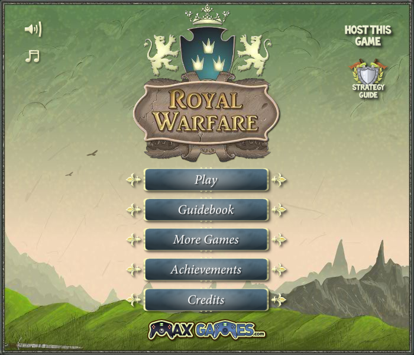

# Royal Warfare 1（Godot macOS 重写）

《Royal Warfare》一代的 Godot 4 原生 macOS 重写工程，独立于二代项目。游戏行为使用 GDScript，运行时不使用 SWF、Flash、Ruffle、Wine 或原版程序。

当前版本为 `0.1.0`：完整一代资源库和战役数据已进入工程，入口已切换到原生移植的 `Main`（`game/core/main.gd`），启动流程（开始按钮 → MaxGames 片头 → 主菜单 → 地图 → 关卡弹窗 → 战斗）、原生战斗、关卡事件与主要界面均已可运行；旧的近似实现（`game/main.gd`、`battle.gd`、`unit.gd`、`specials.gd`、`achievements.gd`、`original_scene.gd` 及 `scenes/ui/`、`assets/ui/`）已删除。**尚未完成与原作的逐关、逐技能等价验收，不能视为最终无损移植版。** 验证范围及差异见 [docs/verification.md](docs/verification.md)。



## 在 Mac 上运行和开发

使用 `/Applications/Godot.app`，推荐 Godot **4.7.2**：

```sh
./dev/godot.sh editor
./dev/godot.sh run
./dev/godot.sh test
./dev/godot.sh export
```

也可以在 Godot 中导入根目录的 `project.godot`。运行整个工程用编辑器右上角 ▶，或 macOS 的 `⌘B`；键盘将 F5 用作系统功能时，使用 `Fn+F5`。主场景已配置为 `scenes/main.tscn`。

导出的 `build/Royal Warfare 1.app` 内含游戏和引擎，可离开工程目录独立运行，支持 Apple Silicon 与 Intel Mac。构建需要 Godot 的 macOS 导出模板；游戏运行不需要安装 Godot。

## 内容与编辑入口

| 路径 | 内容 |
| --- | --- |
| `game/core/main.gd` | 原生移植的 `Main`：启动流程、切屏（`fadeClearLoadUnfade`）、关卡/地图/漫画/面板加载、音乐切换 |
| `game/core/preloader.gd` | 原生移植的 `Preloader`：开始按钮、MaxGames 片头前的加载画面 |
| `game/` 其余目录 | 原生战斗、技能、关卡调度、存档、成就和界面逻辑（`core`/`living`/`projectiles`/`levels`/`service`/`memory`/`ifaces`/`rw`） |
| `game/memory/legacy_save.gd` | 旧版 `user://campaign.json` 存档一次性迁移到新存档 `user://RoyalDefenderGame7.json`（二次开发，原版没有对应类） |
| `scenes/clips/` | 从原版剪辑导出的层级场景（符号类，按原坐标与子实例名） |
| `scenes/ifaces/` | 继承 `scenes/clips/` 并换上界面类脚本的场景 |
| `assets/backgrounds/` | 一代 24 组关卡背景 |
| `assets/library/` | 角色与特效图集、动画、原矢量图、字体、声音和文字 |
| `assets/clips/` | `scenes/clips/` 场景引用的逐符号位图与剪辑数据 |
| `data/campaign.json` | 序章和 24 关，含 313 个原事件、对话与初始配置（仅 `tests/levels_data.gd` 用于校验，运行时不读取） |
| `data/geometry.json` | 原路线、地图元素变换及障碍多边形 |
| `data/save_schema.json` | 存档槽位结构（`NUMPAN_*` 下标），供 `LegacySave` 做旧存档字段映射 |
| `data/xml/` | 完整一代的关卡和单位内容数据，运行时由 `RWXml`/`ExtDataManager` 解析，是实际战斗数值的唯一来源 |

角色和背景可直接替换 PNG/SVG；动画使用 Godot `SpriteFrames`。运行时的单位属性、技能参数、关卡事件均来自 `data/xml/`（原版嵌入 XML），不是 JSON 文件；`data/units.json`、`data/story.json`、`data/special_parameters.json`、`data/bonuses.json`、`data/encyclopedia.json`、`data/achievement_rules.json`、`data/arrows.json`、`data/backgrounds.json`、`data/boss_support.json`、`data/names.json`、`data/recruitment.json`、`data/upgrades.json` 是旧近似实现读取的摘要数据，新代码未引用，已随旧实现一起删除。每个原资源编号在 `data/resources.json` 中都有对应文件。原始下载包、反编译源码、转换工具和过程日志仅留本地，不进入该仓库。

## 操作

左键选兵、拖框多选、双击选择同兵种；右键移动，点击敌人下达攻击。`Shift` 保持队形移动或追加选择。`Q/W/E/R/T` 分别选择战士、弓手、法师、牧师、盗贼；`Ctrl/⌘/Shift+数字` 保存编队，数字召回。

`A` 攻击移动、`S` 防守、按住 `Z` 显示射程、`X/C` 纵横队形；`Space/P` 暂停，`N` 选择可进阶单位，`U` 打开进阶选择。箭雨在相应关卡用 `F` 或原按钮选择落点。招募在关卡内完成；基础兵积满精英经验后可以选择两种进阶职业。星级升级在地图的 Upgrades 中设置。

存档保存在 Godot 用户数据目录的 `RoyalDefenderGame7.json`（原版 `SharedObject` 的名字）。首次启动若该文件不存在、但旧版 `campaign.json` 存在，会自动把关卡星数、兵种解锁、技能、成就、难度、漫画与声音/音乐/自动暂停设置迁移过去；旧文件保持不变。测试使用隔离存档，不覆盖玩家进度。

原游戏内容、美术、音乐及角色的权利归原权利人所有；本仓库不授予这些内容的商业发行权。Steam 接入、商店配置和发行签名不在当前版本内。
